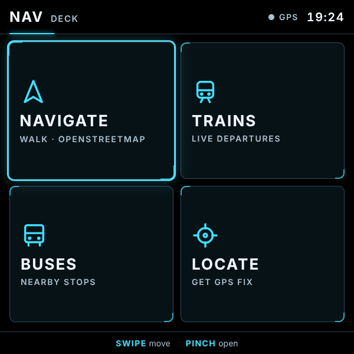
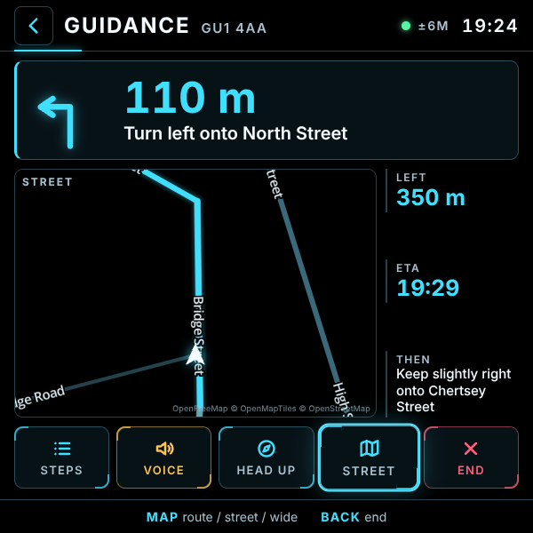
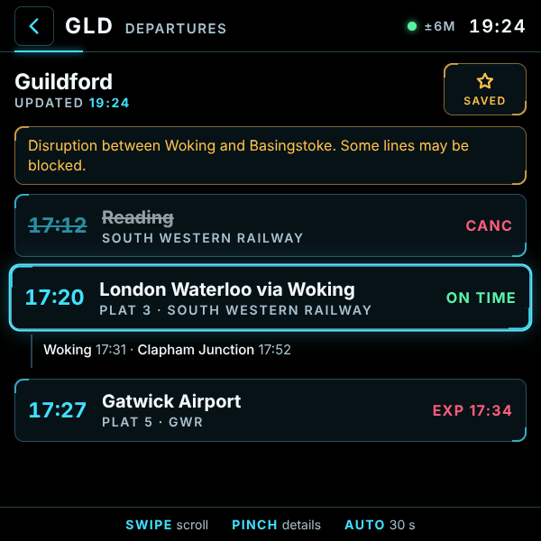
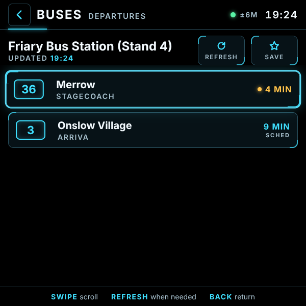

[README.md](https://github.com/user-attachments/files/33979346/README.md)
# Nav Deck

Walking and cycling directions with live train and bus times for **Meta Ray-Ban Display** glasses. Turn-by-turn guidance on OpenStreetMap, a street map you can flick to for a sense of distance, and live departure boards for any station or bus stop in Great Britain. Built for the Display's 600×600 screen and the Neural Band.

- **Walk or cycle:** turn-by-turn directions with distance to the next turn, time left and arrival time
- **Three map views:** route line only, a street map with road names, or zoomed out for the bigger picture
- **Spoken turns:** optional voice prompts through the glasses speaker
- **Search your way:** place names, streets, addresses or postcodes, by handwriting or voice
- **Live trains:** National Rail departures with platforms, delays, cancellations and calling points
- **Live buses:** real-time where operators provide it, timetabled times otherwise
- **Finds what's near you:** nearest stations and stops from your phone's GPS, plus your saved ones
- **Reroutes itself** if you go off course
- **Keys stay on the server:** the page never sees your API keys, and an access code stops strangers using your allowances. Without the code, visitors get a working demo instead

| Home | Guidance (street map) |
|---|---|
|  |  |

| Trains | Buses |
|---|---|
|  |  |

---

## Setup

### 1. Copy the code
Fork this repository, or create your own with these files:

```
index.html
style.css
nav.css
app.js
streetmap.js
demo.js
places.js
icon-96.png
api/_lib.js
api/route.js
api/geocode.js
api/reverse.js
api/nearby.js
api/trains.js
api/buses.js
api/status.js
```

### 2. Import it into Vercel
Choose **Add New → Project** and import the repo.
- **Framework preset:** Other
- **Build command:** leave empty
- **Output directory:** leave as default

> Can't see the repo in Vercel? Click **Adjust GitHub App Permissions** on the import screen and give Vercel access to it.

### 3. Get the keys
All three have free plans.

**Directions and search: openrouteservice (HEIGIT)**
1. Sign up at [openrouteservice.org](https://openrouteservice.org) and open the dashboard.
2. Copy your API key. It's fine if it ends in `=`.

**Trains: Rail Data Marketplace**
1. Register at [raildata.org.uk](https://raildata.org.uk) and confirm your email.
2. Search the data products for **Live Departure Board** (by Rail Delivery Group). Use the plain one, not "Staff version" or "Live Next Departures Board".
3. **Subscribe**, then open it from your subscriptions and copy the **Consumer key**.

**Buses: TransportAPI (runs Traveline NextBuses)**
1. Register at [developer.transportapi.com](https://developer.transportapi.com).
2. Copy the **app ID** and **app key** from **My Apps**. You don't need the app name.
3. The free plan allows **30 requests a day**, so the bus screen only checks when you press **Refresh**.

### 4. Add them to Vercel
In Vercel, go to **Settings → Environment Variables** and add:

| Name | Value |
|---|---|
| `ORS_API_KEY` | Your openrouteservice / HEIGIT key |
| `RAILDATA_API_KEY` | Your Rail Data Marketplace consumer key |
| `TRANSPORTAPI_APP_ID` | Your TransportAPI app ID |
| `TRANSPORTAPI_APP_KEY` | Your TransportAPI app key |
| `APP_CODE` | *Recommended.* Your own access code (letters and numbers). Without it, anyone with your address can use your allowances |
| `RAILDATA_DEPARTURES_URL` | *Optional.* Only if your Live Departure Board address differs from `https://api1.raildata.org.uk/1010-live-departure-board-dep1_2/LDBWS/api/20220120/GetDepartureBoard/{crs}`. Paste it exactly as shown on the product page, `{crs}` included |
| `BUS_REFRESH_SECONDS` | *Optional, paid bus plans only.* Turns on bus auto-refresh, e.g. `60` |

Then **Redeploy** (Deployments → ⋯ → Redeploy). Vercel only picks up variable changes on a new deployment.

### 5. Check it
Open `https://YOUR-PROJECT.vercel.app/api/status?c=YOUR-APP-CODE` (leave off `?c=…` if you haven't set `APP_CODE`). You'll see raw data. Look for:
- `"set": true` on each key.
- `"strippedChars": false`. If it says `true`, the key had stray characters such as spaces removed. That's fine unless the key then stops working.

Then try `https://YOUR-PROJECT.vercel.app/api/trains?crs=GLD&c=YOUR-APP-CODE` for a live Guildford board.

### 6. Add it to your glasses
In the Meta AI app, add a web app with the address `https://YOUR-PROJECT.vercel.app/?code=YOUR-APP-CODE`. The glasses remember the code after the first visit and remove it from the address. If you add it without the code, the app shows a lock screen where you can write or speak it instead. Use the main project address, not a preview link, as preview links can ask for a Vercel login.

## Using it

| Gesture | Where | Action |
|---|---|---|
| Swipe | Anywhere | Move between buttons and list items |
| Pinch | Button or item | Select it |
| Pinch | Search box | Write or speak a place, street, address or postcode |
| Pinch | Walk / Cycle | Choose how you're travelling |
| Pinch | Start | Begin guidance |
| Pinch | Map | Switch between Route, Street and Wide views |
| Pinch | Voice | Turn spoken directions on or off (amber = on) |
| Pinch | Head up | Turn the map with your head, using the glasses' compass |
| Pinch | A train | Show its calling points |
| Pinch | Refresh | Check a bus stop again |
| Pinch | Save / ★ | Keep a place, station or stop for next time |
| Back | Anywhere | Go back a screen (the HUD back button does the same) |

Train boards refresh every 30 seconds while open. Bus stops refresh when you press Refresh.

### Demo mode
Without the access code, the app opens in **demo mode** (an amber **DEMO** light in the top bar). Everything works with sample data made on the glasses: searches, a simulated walk or ride along your route, and example train and bus boards. It never contacts your server, so it costs you nothing and needs no keys. Pinch **Unlock** to enter the code. Add `?demo` to the address to try demo mode at any time.

---

## Saved places, stations and stops

**Save where you are:** on the Destination screen, pinch **Save where I am**. The app takes a precise fix, suggests the nearest address (house number and street where OpenStreetMap has it, plus the postcode), and lets you keep that name or write or speak your own, like "Mum's". Handy when search only knows the street. Pinch **New fix** if the accuracy shown is poor.

Places saved in the app live on the glasses. To make one permanent, or to share it between devices, add it to `places.js`. You can also set defaults there:

```js
places: [
  { name: 'Guildford Station', lat: 51.2369, lon: -0.5803 },
  { name: 'Home', lat: 51.0000, lon: -0.5000 },
],
stations: [
  { crs: 'GLD', name: 'Guildford' },
],
stops: [
  { atco: '4000XXXXXXXX', name: 'Friary Bus Station (Stand 1)' },
],
```

- **Coordinates:** right-click a spot on [openstreetmap.org](https://www.openstreetmap.org) and choose **Show address**.
- **Station codes (CRS):** the three-letter code on any National Rail page, e.g. `GLD` for Guildford.
- **Bus stop codes (ATCO):** click a stop on openstreetmap.org and look for `naptan:AtcoCode`, or find the stop on [bustimes.org](https://bustimes.org).
- `centre` sets where searches are focused before you have a GPS fix.

## Search tips
- **Postcodes** are the most precise way to find a house: `GU1 4AA`, or `12 North Street GU1 4AA`. An area code on its own, such as `GU1`, takes you to the middle of that area.
- **Places and streets** work well: "Guildford Cathedral", "Woodbridge Road".
- **House numbers** are hit and miss. They come from OpenStreetMap, where only some UK addresses are mapped. If one isn't found, add the postcode.
- Results nearest to you come first, and you can search anywhere in Great Britain.

---

## How it works

- **Directions and search:** `api/route.js` and `api/geocode.js` call openrouteservice, which uses OpenStreetMap data. Postcodes go to [postcodes.io](https://postcodes.io), which uses official ONS data and needs no key.
- **Street map:** `streetmap.js` draws OpenStreetMap roads from [OpenFreeMap](https://openfreemap.org) with MapLibre, restyled for the glasses: black is see-through on the Display, so roads are drawn as light and your route is brightest. It loads only the first time you switch to it. If the glasses can't run it (it needs WebGL), the app says so and stays on the route-line view.
- **Nearby stations and stops:** `api/nearby.js` asks OpenStreetMap (Overpass) for stations within 25 km and bus stops within 700 m. Results are cached for a day.
- **Trains:** `api/trains.js` uses National Rail's Darwin feed through Rail Data Marketplace. Cached for 20 seconds.
- **Buses:** `api/buses.js` uses TransportAPI's live departures. Each stop is cached for 90 seconds, so going back and reopening it doesn't use up your daily allowance.
- **Location** comes from your paired phone. Guidance follows your GPS, and the map turns to face your direction of travel, or your head direction with Head up.
- **Privacy:** your location is only sent to the services above to plan routes and find what's nearby, and nothing is stored on the server. Saved and recent places live on the glasses.

## Troubleshooting

| Symptom | Likely cause |
|---|---|
| "Access code needed" or "Wrong access code" | The code on the glasses doesn't match `APP_CODE`. Re-enter it on the lock screen, or open the app once with `?code=` on the end |
| A key shows `"set": false` | Missing or misnamed variable, or no redeploy since adding it |
| "rejected the key" | The key is wrong or expired. Copy it again from the provider |
| Trains error 404 | Your Live Departure Board address differs from the default. Copy it from the product page into `RAILDATA_DEPARTURES_URL`, exactly as shown |
| Trains show no calling points | Your subscription only includes the basic board. Times, platforms and delays still work |
| "Bus allowance used up for today" | The free TransportAPI plan's 30 daily checks are used. It resets at midnight |
| Buses show only "SCHED" times | That operator doesn't send live data, so timetable times are shown |
| "Street map unavailable" | The glasses couldn't start WebGL, or the map couldn't load. The route-line view still works |
| "Location timed out" | The glasses get GPS from your phone. Check the phone is connected and location is on for the Meta AI app |
| No stations or stops found | The OpenStreetMap lookup was busy. Go back and try again |
| Voice is silent | Check the glasses' volume and that Voice is amber |

## Disclaimer

An independent hobby project. Not affiliated with or endorsed by Meta, HEIGIT, Rail Delivery Group, National Rail, TransportAPI, Traveline or Vercel. Directions are a guide only: always follow road signs, crossings and local conditions, and stay aware of your surroundings. Map data © OpenStreetMap contributors. Train data: National Rail Enquiries. Bus data: Traveline NextBuses via TransportAPI.
